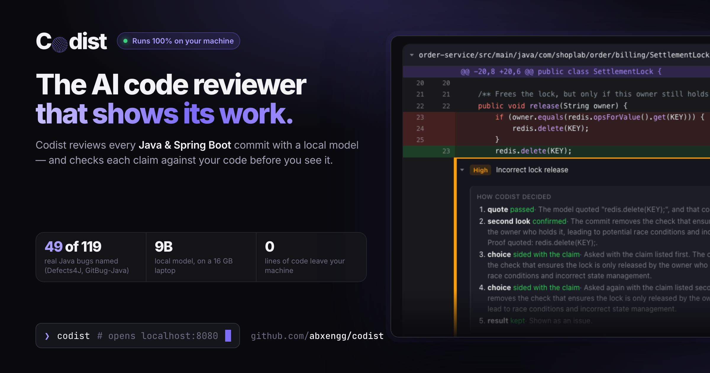

# Codist



Codist reviews a Java and Spring Boot repository on your own machine. It runs as one program next to your code,
watches the repository, and shows what it finds in your browser:

- **Review**: every new commit is checked on its changed lines, then read by a local AI model. Each model claim is
  checked against the code before it is shown, and issues are followed until a later commit fixes them. A claim
  Codist cannot back, or that the code contradicts, is shown as a quiet note with the reason; it opens no issue.
- **Every file, with reasons**: all changed files of a commit are considered. When a commit is too large for the
  model to read in full, the model first says which files need reading and which do not, and the page shows each
  decision and why. One click has a skipped file read after all.
- **Numbers your documents state**: a commit that changes a number your README or spec still states with the old
  value is reported, with the sentence quoted. No model needed.
- **Calls between services**: a Feign client call to a route its service, in the same repository, does not serve is
  reported at the changed line, with the routes that service does serve. No model needed.
- **Chat**: ask about your codebase. Codist finds the classes the question is about and gives the local model their
  code, the services and the open issues; the answer links the files and lines it used.
- **Fix**: for a real bug, the model prepares a small fix and says why. You see the current and proposed code side by
  side, the fix is built and tested in a separate copy first, and only when you approve is it committed (just its own
  files). Tell it how you want it fixed, or reject it and say why; it remembers.
- **Activity**: what Codist is doing right now: what code checks, the AI model and behaviour runs are working on, what
  waits and what just finished, every model call with its prompt and reply, and the log as it happens.
- **Map**: your services, classes and methods on one canvas, with Feign calls between services, what the selected
  commit changed and what that change can affect.
- **Incidents**: paste production logs to see each error, the line of your code it came from, and the commit that
  last changed that line. The model can suggest a cause.
- **Repository**: modules, HTTP routes, Feign calls, hotspots, the largest classes and methods that may be slow.
- **Behaviour** (optional): runs the methods each commit changed on the code before and after it, with the same
  inputs, in a sandbox on macOS and Linux, and shows what now behaves differently. A commit that says it only
  tidies but changes results gets an issue; the model is shown the changed results as facts.

The sidebar keeps Now, Issues, Commits and Chat in view; Incidents, Map, Activity and Repository are under **More**.
Nothing leaves your machine. Codist never changes your code unless you approve a fix.

## How well it finds bugs

Two kinds of test, both with `qwen3.5:9b`, the default model, on a 16 GB laptop.

**Planted bugs.** Three test projects, each built commit by commit by a script in
[codist-eval](https://github.com/abxengg/codist-eval/tree/main/testbed), with an answer key kept outside the project.
A bug counts as found when an alarm (not a note) lands within 6 lines of it; a clean commit fails if it gets any alarm.

| Project | What it is | Bugs found | Clean commits with an alarm |
|---|---|---|---|
| [records-lab](https://github.com/AbiXnash/records-lab) | a Spring Boot gateway: JSON, XML, CSV and GraphQL over JDBC | 18 of 19 | 0 of 5 |
| [shop-lab](https://github.com/AbiXnash/shop-lab) | two Spring Boot services: Feign, Redis, Spring Batch, JDBC | 23 of 24 | 0 of 6 |
| [maze-lab](https://github.com/AbiXnash/maze-lab) | a Java Swing game written to a design spec | 19 of 19 | 1 of 3 |
| all, v0.12.0 | | **60 of 62** | **1 of 14** |
| all, v0.11.2 | | 54 of 62 | 2 of 14 |

v0.12.0 was measured on 2026-11-27 by replaying the model's first readings of the v0.11.2 run with the v0.12.0
rules; a fresh run differs somewhat, because the model's answers vary from run to run. Most of the gain came from
five bugs the model had found and Codist's own filters had hidden. What changed and why, with the research behind
each change: [abxengg/codist#19](https://github.com/abxengg/codist/issues/19).

**Real bugs.** 119 bugs from real Java projects (Defects4J and GitBug-Java), each put back into its project and
reviewed once from scratch. The model **named the bug in 49 of 119**, was near it with a related point in 12 more,
and showed 28 of the 49 as alarms rather than notes. Real bugs are much harder than planted ones; quote 49 of 119, not
60 of 62. Labels are one reader's judgement, and the fixed versions were not reviewed, so this run gives no
false-alarm rate. Details in [docs/comparison.md](docs/comparison.md#real-bugs-v090-2026-11-18).

Code checks alone, with no model, find 11 of 19, 9 of 24 and 5 of 19 of the planted bugs, and at most 6 of the real
ones: they are exact, not broad. The model finds the bugs that need reading the change against your rules.

## Install

**macOS and Linux**

```bash
curl -fsSL https://raw.githubusercontent.com/abxengg/codist/remaster/install.sh | sh
```

**Windows** (PowerShell)

```powershell
irm https://raw.githubusercontent.com/abxengg/codist/remaster/install.ps1 | iex
```

**Docker** (image includes git, a JDK and Maven, for amd64 and arm64)

```bash
cd ~/dev/your-spring-app
docker run --rm -p 8080:8080 -v "$PWD:/repo" -v codist-data:/data \
  --add-host=host.docker.internal:host-gateway ghcr.io/abxengg/codist
```

It reviews the folder mounted at `/repo`, keeps its database in the `codist-data` volume, and reaches Ollama on your
machine at `host.docker.internal:11434` (set `-e CODIST_MODEL_URL=...` for another address). Open
http://localhost:8080. Fixes are committed to the mounted repository only after you approve them, as usual; to
commit as yourself, add `-e GIT_AUTHOR_NAME="$(git config user.name)" -e GIT_AUTHOR_EMAIL="$(git config user.email)"
-e GIT_COMMITTER_NAME="$(git config user.name)" -e GIT_COMMITTER_EMAIL="$(git config user.email)"`.

**With Go** 1.26 or later: `go install github.com/abxengg/codist@latest`

The script downloads the program for your system (or builds it from source if Go is installed and there is no
release yet), puts it on your path, and checks git, Java and the model server. Then:

```bash
cd ~/dev/your-spring-app
codist            # opens http://localhost:8080
```

You need git. Everything else is optional: without a model server Codist still runs its code checks. To add the AI
review, install [Ollama](https://ollama.com) and pull a model:

```bash
ollama pull qwen3.5:9b             # about 8 GB; the default. On 8 GB of memory use qwen2.5-coder:7b
```

Or skip the pull: with Ollama running, Codist's Now page offers to download the model and shows its progress.

Other commands, run in the repository:

| Command | What it does |
|---|---|
| `codist --no-open` | start without opening the browser |
| `codist top [url]` | a live view, in the terminal, of a Codist already running |
| `codist doctor` | the installer's checks: git, Java, the model server and model |
| `codist trust` | agree to the settings in `.codist/config.lua` that wait for you (see [Settings](#settings)) |
| `codist training > findings.jsonl` | export model findings whose outcome is known, one example per line |
| `codist version`, `codist upgrade [vX.Y.Z]` | show the version, or update to the latest (or a given) release |

The full walk-through, with settings and fixes for common problems, is in
[docs/getting-started.md](docs/getting-started.md).

## Settings

Put settings in `.codist/config.lua` in the repository. All are optional:

```lua
model = { url = "http://localhost:11434", name = "qwen3.5:9b", context = 8192 }
max_files = 8            -- changed files per commit the model reads; checks read all of them
history = 50             -- recent commits the model reads in the background; 0 for all. Checks cover every commit
older = false            -- when the model is idle, also read the commits older than `history`, newest first
twice = false            -- read every commit's files twice, not only risky ones: about double the model time
ignore = { "target/", "build/", "generated/" }
behaviour = false        -- run changed methods before and after each recent commit; runs your code, needs a JDK
```

The script runs with no file, network or OS access. Because the file comes with the repository, two settings in it
wait for your word: `behaviour = true`, which runs the repository's code, and a `model.url` on another machine,
which sends your code there. Run `codist trust` in the repository once to agree. Environment variables override it for one run:
`PORT`, `CODIST_MODEL`, `CODIST_MODEL_URL`, `CODIST_MODEL_REVIEW=false`, `CODIST_HISTORY`, `CODIST_OLDER=1`, `CODIST_TWICE=1`, `CODIST_FIRST_WORD`, `CODIST_BEHAVIOUR=1`,
`CODIST_DATA_DIR`, `CODIST_LOG=debug`, `CODIST_LOG_JSON=1`.

## Known issues

What does not work yet, and what is planned, is tracked in [the open work list](https://github.com/abxengg/codist/issues/6). The most important:

- **Very large commits and histories are reviewed thinly.** Checking a history of a million commits takes about a
  day ([#1](https://github.com/abxengg/codist/issues/1)); very large commits are planned by the model, not split
  ([codist-review#1](https://github.com/abxengg/codist-review/issues/1)).
- **Two planted bugs are missed by v0.12.0**: cancelling an order puts back the quantity ordered instead of the
  quantity reserved (shop-lab's rule 5), and a read-only transaction removed from an export, so it can mix data from
  before and after a change. A check for the second is on the main branch, not yet released.
- **Calls between services are checked for Feign clients only**, and only against services in the same repository.
- **A written spec is followed only partly.** With your rules in `.codist/rules.md`, the model catches most broken
  rules. Changed numbers that a document states are caught without the model; other rules it sometimes misses.
- **A full review has not been run on Windows or Linux by a person.** Tests, the installers and the sandbox run on
  all three systems in CI ([#4](https://github.com/abxengg/codist/issues/4)).
- **How each git operation is handled** (merge, rebase, revert, rename, reset): [docs/git.md](docs/git.md).

## How it is built

Codist is split into modules, each its own repository, and built into this one program:

| Repository | What it holds |
|---|---|
| [codist](https://github.com/abxengg/codist) | this app: settings, the HTTP API and the review lanes |
| [codist-review](https://github.com/abxengg/codist-review) | how a commit is reviewed, the issue store, and what the Activity page shows |
| [codist-fix](https://github.com/abxengg/codist-fix) | preparing, checking and applying fixes a person approves |
| [codist-behaviour](https://github.com/abxengg/codist-behaviour) | running changed methods before and after a commit |
| [codist-java](https://github.com/abxengg/codist-java) | the Java parser, code checks, class graph and call graph |
| [codist-git](https://github.com/abxengg/codist-git) | reading a repository through git, and a test repository builder |
| [codist-model](https://github.com/abxengg/codist-model) | the model server client, and reading production logs into incidents |
| [codist-ui](https://github.com/abxengg/codist-ui) | the Svelte interface, embedded already built |
| [codist-eval](https://github.com/abxengg/codist-eval) | the test projects with planted bugs and their scores, the benchmark, and the behaviour-difference experiment |

[docs/architecture.md](docs/architecture.md) shows how they fit together, and
[docs/development.md](docs/development.md) how to work on them: one script clones them all side by side.
[docs/ai-engineering.md](docs/ai-engineering.md) maps the ideas in Chip Huyen's *AI Engineering* to Codist.

```bash
make build    # bin/codist; no C compiler needed
make test
make dist     # one file each for macOS, Linux and Windows
```

Data is kept in `~/.codist/<repo>-<hash>.db`, a SQLite file named after the repository's folder and full path.

## Share

Images for posts and stories are in [docs/ad](docs/ad): a [square](docs/ad/codist-ad-square.png) (1080×1080), a
[wide](docs/ad/codist-ad-wide.png) (1200×630) and a [story](docs/ad/codist-ad-story.png) (1080×1920). They are made
from [docs/ad/ad.html](docs/ad/ad.html) by `node docs/ad/render.mjs`, which needs Chrome. The bug numbers on them are
the real-bug results above.

## Licence

Source available under the [PolyForm Noncommercial License 1.0.0](LICENSE): free for any noncommercial purpose, such
as personal study, research, hobby projects and testing, and for use by charities, schools, public research and
public health bodies and government institutions. **Using it for a business, or in anything sold, needs a commercial
licence** from the author: open an issue at [github.com/abxengg/codist](https://github.com/abxengg/codist/issues)
to ask. Third-party code included in Codist keeps its own licence.

Required Notice: Copyright 2026 Abinash (https://github.com/AbiXnash)
